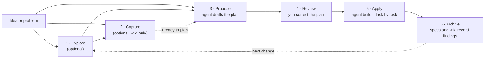

# Quickstart

> Your first change, from idea to archived, in a new or existing project.

Before you start, you need the CLI on your machine ([Installation](installation.md)) and OpenSpec initialized in your project ([Set up your project](setup.md)).

## Start from an empty project

You can start without a chosen stack or a complete architecture. Initialize OpenSpec in your project folder, then ask your agent to explore the options with you. In your AI chat:

```text
Help me explore a task tracker from scratch. I have not picked a stack. Compare the options and help me choose the first behavior to build.
```

Decide what the first change needs and leave later architecture choices open. If you want to keep useful findings without proposing a change yet, use Capture. Otherwise, ask your agent to propose the first change, then follow the steps below. You can revisit the architecture as the project grows.

## The loop at a glance

Explore and Capture are optional. Propose, review, apply, and archive form the change workflow. Archive updates the wiki when a completed change adds useful information.



Every prompt below goes in your AI chat, the same place you ask for code. The examples use plain language so they work across tools. You can also invoke a skill directly; the syntax varies by tool ([supported tools](../reference/supported-tools.md)).

## Step 1: Explore

Think the idea through with your agent before you ask for a plan. Explore reads relevant pages and references from `openspec/wiki/` when that folder exists. It does not edit them. In your AI chat:

```text
Help me explore how rate limiting should work in this app.
```

Explore is a thinking mode. The agent investigates your codebase, asks the questions that matter, sketches options, and challenges assumptions. It never writes code or wiki files. The output is a sharper idea.

Stay here as long as the problem needs. When the shape feels right, save reusable findings with Capture or go straight to Propose.

## Step 2: Capture information in the wiki (optional)

Use Capture to preserve decisions, hypotheses, and open questions without creating a change proposal or implementing code. In your AI chat:

```text
Capture the options and open questions from our discussion in the wiki.
```

Capture updates relevant topic pages under `openspec/wiki/` and preserves original reference files. These files live under the OpenSpec root, so Git can version them with the rest of that root. Skip Capture when there is nothing durable to save. Archive reviews the wiki after a completed change, even when you skip Capture.

## Step 3: Propose

Propose turns the idea into a reviewable plan. Coming from Explore or Capture, ask your agent to propose the discussed change. Starting cold, when the change is clear in your head, ask directly. In your AI chat:

```text
Propose the change we just discussed.
```

That request carries forward what you settled. If you are starting cold, use a specific request such as "Propose a change to add rate limiting."

The agent asks what it needs to, then writes a change folder:

```
openspec/changes/add-rate-limiting/
├── proposal.md    why, and what changes
├── specs/         what "done" means, as testable requirements
├── design.md      technical decisions (only when the change needs one)
└── tasks.md       the implementation checklist
```

No code yet. Propose stops at the plan.

## Step 4: Review and correct the plan

Fix the plan while it's still words and nothing is built yet. Read in this order:

- **`proposal.md`**: is this the right problem, at the right size?
- **`specs/`**: the highest-value read. Would you accept these requirements as done?
- **`tasks.md`**: do the tasks cover the specs, and nothing more?

To fix something, either works:

- Edit the file yourself. The artifacts are plain markdown, and the files are the plan.
- Tell your agent what's wrong ("the spec is missing the unauthenticated case"). It revises the artifacts.

## Step 5: Apply

Apply turns the plan into code. Start a fresh chat session, since implementation goes better on a clean context window. In your AI chat:

```text
Apply the add-rate-limiting change.
```

The agent reads the change folder, then works through `tasks.md`, checking off each task as it lands.

- **Interrupted, or out of context?** Open a new session and ask it to apply again. It resumes at the first unchecked task.
- **Plan turned out wrong?** Fix the artifacts (either way from step 4), then continue applying.
- **Progress** lives in the `tasks.md` checkboxes. There is no hidden state.

## Step 6: Archive

Archive updates your main specs with the change's requirements and moves the change folder into `openspec/changes/archive/`. After the move succeeds, it updates relevant wiki pages when the change adds useful information.

When every box in `tasks.md` is checked, in your AI chat:

```text
Archive the add-rate-limiting change.
```

Step through what archiving does:

```file-steps
## The finished change
> Implementation is done. The delta spec (what this change adds) still sits inside the change folder; specs/ doesn't know about rate limiting yet.
  openspec/
  ├── specs/                                   (no rate-limiting spec yet)
  └── changes/
      └── add-rate-limiting/
          ├── proposal.md
          ├── tasks.md                         every box checked
          └── specs/
              └── rate-limiting/
                  └── spec.md                  the delta: ADDED requirements

## Requirements land in specs/
> Each requirement in the delta lands in the main spec: added ones append, modified ones replace their old version. A new capability gets a new spec file.
  openspec/
  ├── specs/
+ │   └── rate-limiting/
+ │       └── spec.md                          gains "Requirement: Rate limiting"
  └── changes/
      └── add-rate-limiting/
          └── specs/
              └── rate-limiting/
                  └── spec.md                  the delta, source of the merge

## The folder moves to archive/
> The whole change folder, delta included, moves into the archive under a date prefix. Nothing is deleted.
  openspec/
  ├── specs/
  │   └── rate-limiting/
  │       └── spec.md
  └── changes/
-     └── add-rate-limiting/
+     └── archive/
+         └── 2026-08-08-add-rate-limiting/
+             ├── proposal.md
+             ├── tasks.md
+             └── specs/rate-limiting/spec.md

## Specs describe the system as built
> changes/ is clear for the next change. specs/ is the source of truth for what the system does; archive/ is the history of how it got there.
  openspec/
  ├── specs/
  │   └── rate-limiting/
  │       └── spec.md                          the spec as built
  └── changes/
      └── archive/
          └── 2026-08-08-add-rate-limiting/
```

Git is a separate concern. Commit the change folder with the code, and nothing else about your workflow changes.

Archive leaves the wiki unchanged when there is nothing useful to record. If a wiki update fails, the change remains archived and Archive reports the incomplete update separately.

### Keep or prune archived changes

`openspec/changes/archive/` keeps the proposal, design, tasks, and delta for each finished change. In the archive flow above, the delta has already updated `openspec/specs/`.

- **Keep the whole change folder** when you want a self-contained record in the current checkout.
- **Remove an archived change's `specs/` folder** when Git is your spec history. Commit the archive first, then delete `openspec/changes/archive/<change>/specs/`. The proposal, design, and tasks remain in the checkout. `openspec validate --archived` still works because it checks task completion, not applied deltas.
- **Remove the whole change folder** only when you no longer need its proposal, design, or task history in the checkout. The current specs do not change, but `openspec validate --archived` and searches of the checkout no longer include that change.

> [!WARNING]
> Keep the archive commit in your repository history if you want Git to retain the deleted files. Squashing the archive and cleanup commits together removes that intermediate snapshot.

OpenSpec does not prune archived changes automatically or provide a retention setting.

## Going further

- [Delta specs](../reference/schemas/spec-driven/index.md#delta-specs-specmd): how to write the behavior changes in a delta spec.
- [Profiles](../customize/profiles.md): choose which workflows to install.

## Advanced guides

<!-- Planned pages, not yet written or in the README page map. Listed here so the quickstart routes to them once they exist. -->

Not written yet; guides we plan to add:

- **Prototype first**: spike the code before any spec, then backfill the proposal from what the prototype taught you.
- **Building iteratively**: a sequence of small changes instead of one big proposal.
- **Revising an implemented change**: the plan needs to move again after apply, but the change hasn't merged or archived yet.
